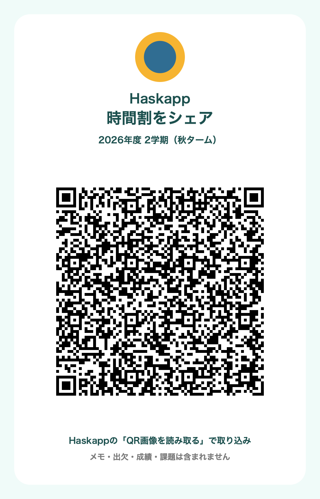
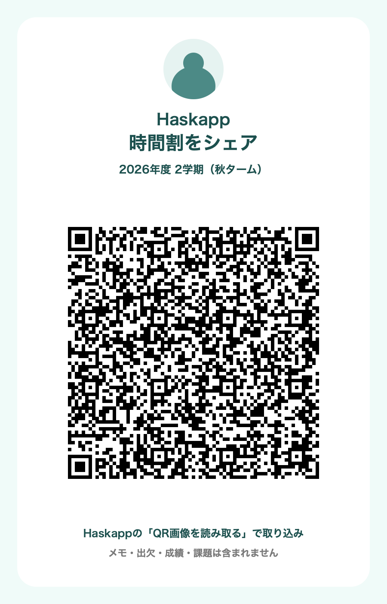

# 2026-10-20 開発進捗

**実装済みと実機合格は別です。** 先行版の既存署名での上書きインストール・起動・既存授業表示は確認しました。最新版 `1.0.0 (1020.2)` はiPhone 15へデータ保持の上書きインストール済みです。起動は端末ロックでOSに拒否され、解除待ちです。最新版の起動・UI合格とは記載しません。本人の時間割・プロフィール画像・端末スクリーンショットはこのリポジトリに含めていません。

| 機能 | コードの状況 | 残る確認・依存 |
|---|---|---|
| 1 チュートリアル説明 | 説明を追加 | 実機の操作確認 |
| 2 テンプレート前後プレビュー | 曜日・時限のプレビュー | 選択・適用・キャンセルの実機確認 |
| 3 重複登録防止 | 手動・公式・QR・共有時限の保存前検証 | 実機操作確認 |
| 4 詳細の関連課題 | 個人・公式・共有・活動の関連ID対応 | 実機操作確認 |
| 5 ELMS/Moodle上部配置 | 既存詳細の上部に配置 | リンク遷移・本人認証後の到達確認 |
| 6 作業中 | 通常課題とiCalの端末内3状態 | 実機保存・再起動確認 |
| 7 予定の講義関連付け | 所有者別に関連ID保存 | 実機編集・再表示確認 |
| 8 予定/期限と講義色 | 記号・色・関連先テーマ | 実機での識別性確認 |
| 9 カレンダーの予定名 | 月・週・当日一覧 | 長い名前・複数件の表示確認 |
| 10 月/週切替 | 月曜始まり7日と前後週 | 実機操作確認 |
| 11 公開サークル情報 | 画面・読込・DB/RLS | 既定OFF、正式掲載データは未登録 |
| 12 時限なし活動 | 所有者別端末内保存・課題/予定連携 | 実機操作確認、クラウド同期なし |
| 13 QR化・画像読取 | 先頭プレビュー、講義ID単位の集約、全時限保持、複数枚化、明示エラー | 実機で未表示報告の修正効果と写真読取を確認 |
| 14 QR共有 | プロフィール画像付きカード、写真保存、標準共有シート | 実機の写真保存・共有操作は未確認。SNS投稿なし |
| 15 講義チャット | 履歴・明示送信・下書き・再送・DB/RLS | 既定OFF、実送受信未確認、公式科目の共有講義への対応付けが必要。Realtime未追加 |
| 16 企業広報 | 掲載データに基づく控えめな表示 | 既定OFF、正式掲載データは未登録 |

追加修正: 時間割/検索の詳細はToday/Calendarと同じ既存詳細ページへのpushに統一。成績の年度・教員選択行を折返し表示へ変更。いずれも最新修正の実機確認は未実施です。

テンプレートには「追加/表示を置換」、対象ターム・前後のプレビュー・最終確認・Undoを実装しています。元の授業・成績・メモ・課題・共有グループを削除せず、この端末の表示を置換します。置換前の完全な表示と新表示を1つのレコードへ永続化した後にUIを反映し、失敗時は旧表示を維持します。Webや別端末の履修登録を置換する機能ではありません。実機の実データでの置換は未実施です。

## 検証

- TypeScript/ESLint、自動アプリ214件・既存契約201件、nativeモデル154件: 作業ツリーで合格。公開スナップショットのTypeScript/ESLint・アプリ214件・nativeモデル154件も合格。契約テスト201件も合格。
- ローカル使い捨てDBで認可・削除分離26件: 合格。ライブ投稿や削除による試験はしていません。
- 承認済みの新表2つを既存接続先へ適用済み。既存のポリシー・権限・行数は不変。正式掲載データや機能フラグの有効化は含みません。
- 最新のiPhone向け署名ビルド: `1.0.0 (1020.2)` のReleaseビルド、既存チーム署名、deep/strict署名検証が成功。Swiftの型推論・置換payloadの型エラーは修正済み。
- 実機: 旧 `1.0.0 (1)` から `1.0.0 (1020.2)` へ上書き成功し、端末上の版番号を再照会して一致。bundle IDは `jp.haskapp.ios`。アンインストール・初期化・ログアウトなし。起動要求はOSのLockedエラーで拒否されたため、ロック解除後の起動確認が残っています。
- 実機UIの回帰試験: 未実行。シミュレータの操作もしていません。

## 安全な画像付き進捗

以下は**共有カードのPNG出力例（macOSで生成）**です。iPhone/シミュレータの画面スクリーンショットではありません。円形アイコンは検証用の図形、時間割は架空のテスト科目です。本人のプロフィール画像・授業・認証情報は使っていません。

実際に保存したPNGをVisionで読み取り、同一講義の複数曜日・教室が復元できることを確認しました。長い25枠の時間割も9枚のカードから欠落なく復元しました。画面表示だけの確認ではありません。iPhoneで写真保存・標準共有後に再読取する操作は残っています。

実際のアプリ画面の安全なスクリーンショットは、端末の接続が戻ってから追加します。未確認の実機動作を完了とは記載しません。
